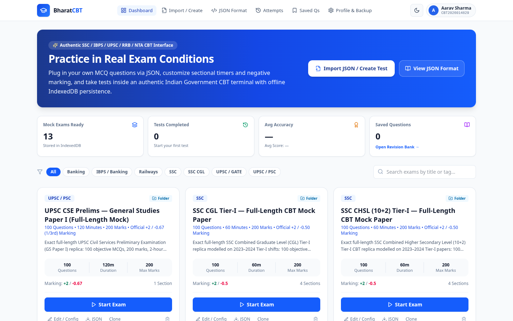
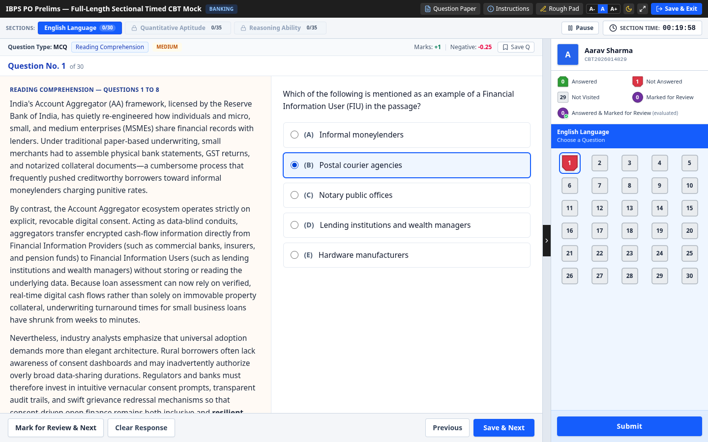
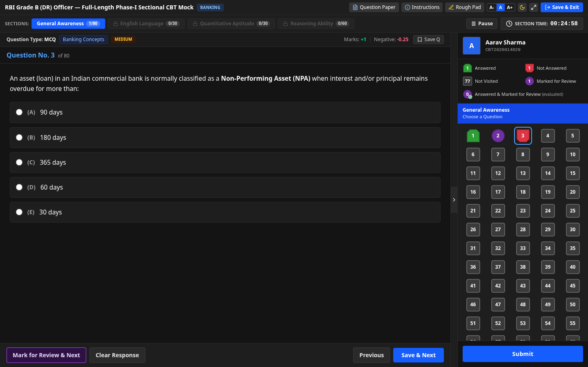

<div align="center">
  
  <h1>BharatCBT</h1>
  <p><strong>Indian Government Exam Mock CBT Portal &amp; Offline Assessment Studio</strong></p>
  <p>
    A production-ready, zero-backend <strong>Computer Based Test (CBT)</strong> simulator modeled on the
    <strong>TCS iON / SSC / IBPS / SBI / UPSC / RRB / RBI / NTA</strong> examination interface—complete with
    <strong>10 full-length official-pattern mock exams (1,090 questions)</strong>, sectional timers,
    custom JSON import, bilingual support, KaTeX math rendering, and persistent offline <code>IndexedDB</code> analytics.
  </p>

  <p>
    <a href="https://react.dev/"></a>
    <a href="https://www.typescriptlang.org/"></a>
    <a href="https://tailwindcss.com/"></a>
    <a href="https://vite.dev/"></a>
    <a href="https://vitest.dev/"></a>
    <a href="./.github/workflows/deploy-pages.yml"></a>
    <a href="./LICENSE"></a>
  </p>

  <p>
    <a href="#preview">Preview</a> &bull;
    <a href="#key-features">Features</a> &bull;
    <a href="#included-full-length-mock-exam-library-user_exam_jsons">Mock Exam Library</a> &bull;
    <a href="#quick-start--local-development">Quick Start</a> &bull;
    <a href="#deploy-to-github-pages">GitHub Pages</a> &bull;
    <a href="#custom-json-format">JSON Format</a> &bull;
    <a href="#contributing">Contributing</a>
  </p>
</div>

---

## Preview

### Exam Studio Dashboard


### Live Split-Pane CBT Terminal (Reading Comprehension & Sectional Timers)


### Low-Glare Dark Mode (200-Question RBI Grade B Phase-I Terminal)


---

## Key Features

### Authentic Indian Govt CBT Terminal
- **Candidate Login & 2-Step Instructions**: Simulated `C001` terminal header, candidate roll/avatar profile, official 5-state palette legend, section-wise marking scheme table, language selector, and exam declaration checkbox.
- **Full-Screen Live Exam Workspace**:
  - Single-line dark top toolbar with **Question Paper** viewer, **Instructions** drawer, **Scientific Calculator** (GATE/CAT-style), **Digital Rough Pad**, font scaling (`A- / A / A+`), theme toggle, fullscreen mode, and **Save & Exit**.
  - **Section Tabs & Locked Sectional Timers**: Live answered counters, composite or section-locked `HH:MM:SS` countdown timers with critical alerts, and automatic section progression.
  - **5-State SVG Question Palette**: *Not Visited*, *Not Answered*, *Answered*, *Marked for Review*, and *Answered & Marked for Review* (with configurable evaluation rules).
  - **TCS iON Action Controls**: `Save & Next`, `Mark for Review & Next`, `Clear Response`, `Previous`, `Submit`, collapsible sidebar palette, and mobile drawer.
- **Per-Attempt Randomization**: Shuffles question order (within each section) and option order per attempt while accurately tracking answers, solutions, and pause/resume snapshots.
- **Rich Question Rendering**: Split-pane **Reading Comprehension / Cloze / Data Interpretation / Puzzle** passages, **Bilingual (`en` / `hi`)** switching, **KaTeX** mathematical typesetting, Markdown tables, and XSS-sanitized inline SVG diagrams.

### Mock Library, Customization & Analytics
- **Auto-Verified `User_Exam_JSONs/` Library**: Automatically discovers, syntax-checks, and schema-validates all `.json` mock papers in [`User_Exam_JSONs/`](./User_Exam_JSONs) on startup.
- **Themes & 8 Accent Presets**: Ships with a crisp **Light** default theme (`Classic CBT Blue`) plus a low-glare **Dark** graphite theme and 8 accent palettes (`Classic CBT Blue`, `Saffron Orange`, `Emerald Green`, `Royal Indigo`, `Violet`, `Teal Cyan`, `Crimson Rose`, `Amber Gold`).
- **Import & Visual Exam Builder**: Paste JSON, drag-and-drop `.json` files, or build/edit exams visually with one-click presets (**SSC CGL**, **IBPS/SBI PO**, **UPSC CSE**, **RRB NTPC**, **NTA JEE/CUET**, **GATE**, **Practice**).
- **100% Offline & Privacy-First Persistence**: Stores exams, auto-saved active sessions, attempt history, per-question time analytics, bookmarks, and notes locally in `IndexedDB` (with `localStorage` fallback), plus full `.json` workspace backup/restore.
- **Post-Exam Analytics & Mistake Retry**: Overall score vs cutoff, positive/negative marks breakdown, section-wise and topic-wise accuracy, filterable solution review, and one-click **"Retry Wrong & Skipped Questions"** CBT mode.

---

## Included Full-Length Mock Exam Library (`User_Exam_JSONs/`)

On startup, BharatCBT automatically verifies and loads **10 full-length official-pattern Indian Government mock examinations** totaling **1,090 unique questions** alongside **3 built-in showcase demos** (`SSC CGL Tier-I Pattern Mini Mock`, `IBPS PO Prelims Sectional Timer Demo`, and `UPSC Prelims & GATE MSQ Showcase`):

| # | Mock Paper | Category | Questions | Max Marks | Sections | Official Timer | Marking Scheme | Options |
| :-: | :--- | :--- | :-: | :-: | :-: | :--- | :--- | :-: |
| 01 | [`01_UPSC_CSE_Prelims_GS1_Mock.json`](./User_Exam_JSONs/01_UPSC_CSE_Prelims_GS1_Mock.json) | UPSC / PSC | 100 | 200 | 1 (GS Paper I) | 120 min (composite) | `+2 / -0.6667` | 4 |
| 02 | [`02_SSC_CGL_Tier1_Mock.json`](./User_Exam_JSONs/02_SSC_CGL_Tier1_Mock.json) | SSC | 100 | 200 | 4 (25 each) | 60 min (composite) | `+2 / -0.50` | 4 |
| 03 | [`03_SSC_CHSL_Tier1_Mock.json`](./User_Exam_JSONs/03_SSC_CHSL_Tier1_Mock.json) | SSC | 100 | 200 | 4 (25 each) | 60 min (composite) | `+2 / -0.50` | 4 |
| 04 | [`04_SSC_MTS_Havaldar_Mock.json`](./User_Exam_JSONs/04_SSC_MTS_Havaldar_Mock.json) | SSC | 90 | 270 | 2 (40 + 50) | 90 min (45+45 sectional) | S-I `+3 / 0`, S-II `+3 / -1` | 4 |
| 05 | [`05_IBPS_PO_Prelims_Mock.json`](./User_Exam_JSONs/05_IBPS_PO_Prelims_Mock.json) | Banking | 100 | 100 | 3 (30 + 35 + 35) | 60 min (20+20+20 sectional) | `+1 / -0.25` | 5 |
| 06 | [`06_SBI_PO_Prelims_Mock.json`](./User_Exam_JSONs/06_SBI_PO_Prelims_Mock.json) | Banking | 100 | 100 | 3 (40 + 30 + 30) | 60 min (20+20+20 sectional) | `+1 / -0.25` | 5 |
| 07 | [`07_IBPS_Clerk_Prelims_Mock.json`](./User_Exam_JSONs/07_IBPS_Clerk_Prelims_Mock.json) | Banking | 100 | 100 | 3 (30 + 35 + 35) | 60 min (20+20+20 sectional) | `+1 / -0.25` | 5 |
| 08 | [`08_RRB_NTPC_CBT1_Mock.json`](./User_Exam_JSONs/08_RRB_NTPC_CBT1_Mock.json) | Railways (RRB) | 100 | 100 | 3 (40 + 30 + 30) | 90 min (composite) | `+1 / -0.3333` | 4 |
| 09 | [`09_RRB_JE_CBT1_Mock.json`](./User_Exam_JSONs/09_RRB_JE_CBT1_Mock.json) | Railways (RRB) | 100 | 100 | 4 (30 + 25 + 15 + 30) | 90 min (composite) | `+1 / -0.3333` | 4 |
| 10 | [`10_RBI_Grade_B_Phase1_Mock.json`](./User_Exam_JSONs/10_RBI_Grade_B_Phase1_Mock.json) | Banking & Regulatory | 200 | 200 | 4 (80 + 30 + 30 + 60) | 120 min (25+25+25+45 sectional) | `+1 / -0.25` | 5 |

---

## Keyboard Shortcuts (Inside CBT Runner)

| Key | Action |
| :--- | :--- |
| `1` – `8` | Select / toggle option `A` – `H` |
| `Enter` / `→` | Save & move to Next question |
| `←` | Move to Previous question |
| `M` | Mark for Review & Next |
| `C` | Clear current response |

---

## Quick Start & Local Development

Requires **Node.js 20+** (Node 22 recommended; pinned in [`.nvmrc`](./.nvmrc)).

```bash
# 1. Clone the repository
git clone https://github.com/<your-username>/<your-repo>.git
cd <your-repo>

# 2. Install exact dependencies
npm ci

# 3. Start the Vite development server (http://localhost:3000)
npm run dev
```

### Verification Commands

```bash
npm run lint     # TypeScript strict typecheck (tsc --noEmit)
npm test         # Vitest unit tests + full 1,090-question JSON validation suite
npm run build    # Typecheck + optimized static production bundle in dist/
npm run preview  # Serve production build locally on http://localhost:3000
```

---

## Deploy to GitHub Pages

BharatCBT is configured with relative asset paths (`base: './'`), hash routing (`#/...`), `public/.nojekyll`, and an automated GitHub Actions workflow ([`.github/workflows/deploy-pages.yml`](./.github/workflows/deploy-pages.yml)) so it deploys smoothly to both project URLs (`https://<user>.github.io/<repo>/`) and custom domains.

### One-Time Setup on GitHub
1. Push this repository to GitHub (default branch `main` or `master`).
2. Open **Repository Settings → Pages → Build and deployment**.
3. Under **Source**, select **GitHub Actions**.
4. Every push to `main` (or manual run via **Actions → Deploy to GitHub Pages → Run workflow**) automatically runs:
   - `npm ci`
   - `npm run lint` (TypeScript check)
   - `npm test` (unit & mock JSON verification)
   - `npm run build` (static production build)
   - Publishes `dist/` directly to GitHub Pages.

### Other Deployment Targets
- **Vercel**: Includes [`vercel.json`](./vercel.json). Import the repository in Vercel or run `npx vercel --prod`.
- **Netlify**: Includes [`netlify.toml`](./netlify.toml). Connect the repository or publish `dist/`.
- **Docker / Nginx**: Includes multi-stage [`Dockerfile`](./Dockerfile) and hardened [`nginx.conf`](./nginx.conf):
  ```bash
  docker build -t bharat-cbt .
  docker run -p 8080:80 bharat-cbt
  ```

---

## Custom JSON Format

- Drop any valid `.json` mock paper into [`User_Exam_JSONs/`](./User_Exam_JSONs) for automatic discovery and verification on startup, or import papers directly via **Import / Create** in the app UI.
- See [`EXAM_JSON_FORMAT.md`](./EXAM_JSON_FORMAT.md) for the complete schema reference, bilingual (`en` / `hi`) fields, shared `passages` / `passageId` blocks, MSQ support, and KaTeX LaTeX guidelines.

---

## Project Structure

```text
├── .github/
│   ├── ISSUE_TEMPLATE/         # Bug report, feature request & mock exam fix templates
│   ├── workflows/
│   │   ├── ci.yml              # Automated lint, test & build verification on push/PR
│   │   └── deploy-pages.yml    # Automated build & publish to GitHub Pages
│   ├── dependabot.yml          # Weekly npm & GitHub Actions dependency updates
│   └── pull_request_template.md
├── docs/
│   └── screenshots/            # High-resolution README screenshots
├── public/
│   ├── .nojekyll               # Ensures clean static asset serving on GitHub Pages
│   └── favicon.svg             # Application emblem & browser icon
├── src/
│   ├── __tests__/              # Vitest suites (jsonParser, scoring, userExamLoader)
│   ├── components/
│   │   ├── cbt/                # CBTExamRunner, LoginScreen, InstructionsScreen, Calculator, RoughPad
│   │   ├── common/             # Navbar, MathText (KaTeX + SVG sanitizer), Modal, Toast, ErrorBoundary
│   │   └── studio/             # Dashboard, ExamBuilder, AttemptResults, HistoryView, BookmarksView, SettingsView
│   ├── constants/              # Accent presets, Indian exam presets, built-in sample demos
│   ├── context/                # AppProvider (hash routing, theme/accent state, IndexedDB sync)
│   ├── storage/                # IndexedDB + localStorage persistence & JSON backup/restore
│   ├── types/                  # TypeScript domain models
│   └── utils/                  # jsonParser, scoring, userExamLoader, formatters
├── User_Exam_JSONs/            # 10 auto-loaded full-length Indian Govt mock papers (1,090 Qs)
├── CHANGELOG.md                # Release history
├── CODE_OF_CONDUCT.md          # Community standards (Contributor Covenant v2.1)
├── CONTRIBUTING.md             # Contribution workflow & JSON authoring guidelines
├── Dockerfile                  # Multi-stage Node 22 + Nginx 1.27 production image
├── EXAM_JSON_FORMAT.md         # Complete JSON schema & KaTeX notation guide
├── LICENSE                     # MIT License
├── netlify.toml                # Netlify SPA build & security headers config
├── nginx.conf                  # Nginx SPA routing, gzip, cache & security headers
├── SECURITY.md                 # Client-side privacy model & vulnerability reporting policy
└── vercel.json                 # Vercel SPA build & security headers config
```

---

## Contributing

Contributions—whether UI refinements, accessibility improvements, parser enhancements, or new/updated exam papers—are warmly welcomed!

- Read [`CONTRIBUTING.md`](./CONTRIBUTING.md) for local setup and PR verification requirements.
- Review [`CODE_OF_CONDUCT.md`](./CODE_OF_CONDUCT.md) for community expectations.
- Report security issues privately following [`SECURITY.md`](./SECURITY.md).

## License

Released under the [MIT License](./LICENSE).
